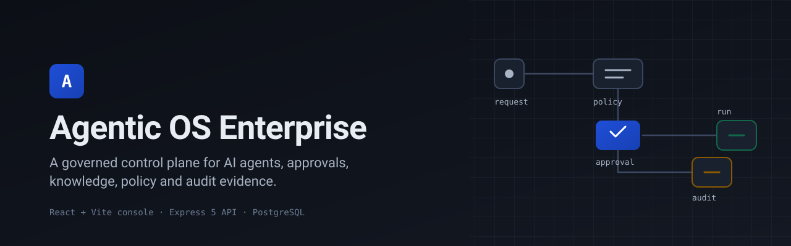
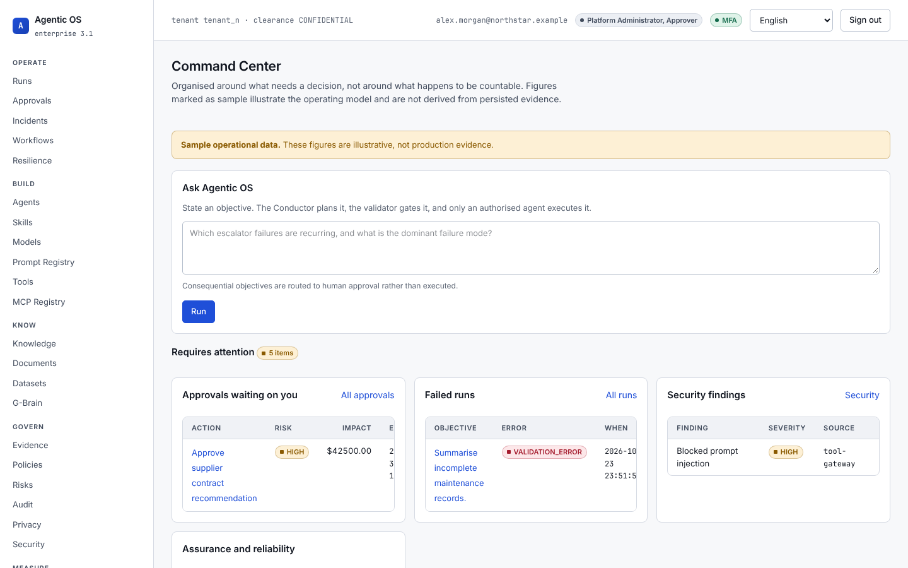
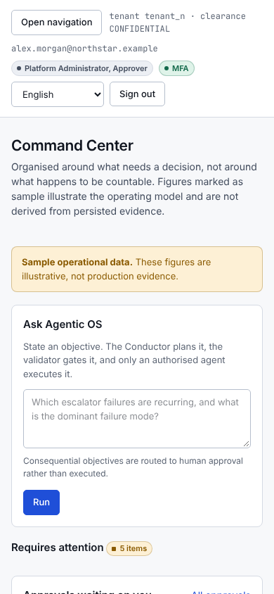
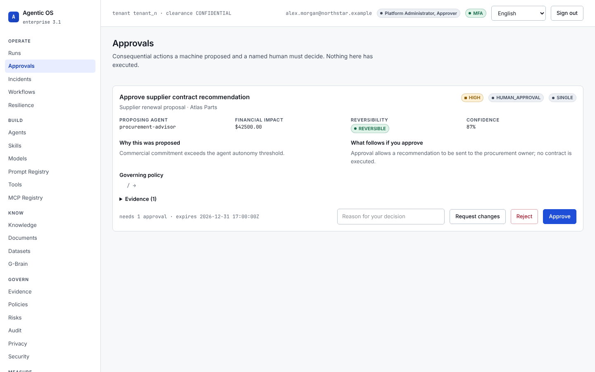
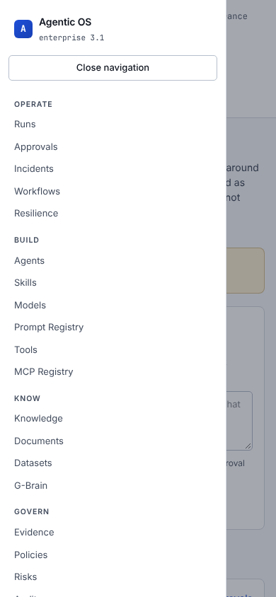
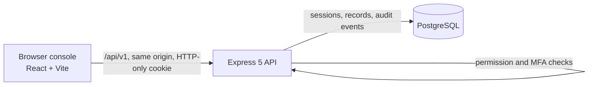

<p align="center">
  
</p>

<p align="center"><strong>A governed control plane for operating AI agents, human approvals, knowledge, policy, security and audit evidence from one console.</strong></p>

<p align="center">
  
  
  
  
  
  
  
</p>

---

## Overview

Agentic OS Enterprise is an operator console for running AI agents under governance. Operators launch runs, decide approvals, inspect agent contracts, search knowledge, review policy and privacy posture, operate security kill switches and inspect a hash-verified audit trail.

The active runtime is a pnpm monorepo:

- `artifacts/agentic-os`: the React + Vite web console.
- `artifacts/api-server`: an Express 5 API with session authentication, permission checks and audit logging.
- `lib/db`: the PostgreSQL schema and migrations (Drizzle ORM).

PostgreSQL holds users, sessions, mutable records and audit events. Several console surfaces still show **sample operational data**. The console labels those surfaces as sample, and they are not derived from persisted evidence.

## Key features

- **Session authentication.** Random session identifiers, stored only as hashes, delivered in HTTP-only cookies. Privileged actions require an MFA-satisfied session.
- **Origin checks.** Mutating requests from an untrusted origin are rejected with HTTP 403.
- **Command Center.** One page for what needs a decision: pending approvals, failed runs, security findings and reliability signals.
- **Governed runs.** State an objective; consequential objectives are routed to human approval instead of being executed.
- **Approvals.** Approve or reject pending actions. Each decision is written to the audit log.
- **Agent registry views.** Agents, skills, models, prompt registry, tools and MCP registry.
- **Knowledge.** Search, documents, datasets and a graph view with impact lookup.
- **Governance.** Evidence, policies and policy decisions, risks, privacy, and an audit log with chain verification (`/api/v1/audit/verify`).
- **Security.** Security findings and kill switches (MFA required to change).
- **Operations.** Analytics, cost, outcomes, incidents, workflows, resilience, organization and capabilities.
- **Arabic and English chrome.** Navigation and controls are translated, and the document direction switches to RTL for Arabic. Page bodies stay in English until a native reviewer supplies translations, and the console says so.
- **Light and dark themes** that follow the operating system setting.
- **Clear failure states.** If the API is not reachable, the console says so and offers a retry instead of failing silently.

## Screenshots

Captured from a local run with `AGENTIC_DEMO_MODE=true` and the seeded demo identity. All figures shown are demo data.

| Desktop (1440 x 900) | Mobile (390 x 844) |
| --- | --- |
|  |  |
|  |  |

Sign-in screen: [`docs/assets/screenshots/login-desktop.png`](docs/assets/screenshots/login-desktop.png). Older captures are kept in [`screenshots/`](screenshots).

## Quick start

Requirements: Node.js 22 or later (the Replit environment uses Node.js 24), pnpm 10, and PostgreSQL 16.

```bash
pnpm install --frozen-lockfile

# 1. Database
export DATABASE_URL=postgresql://USER@localhost:5432/agentic
pnpm --filter @workspace/db run migrate

<p align="center"><br><sub><em>Concept image (AI-generated). Not a product screenshot.</em></sub></p>

# 2. API on port 8080 (demo mode seeds one demo identity)
pnpm --filter @workspace/api-server run dev

# 3. Console on port 22832, forwarding /api to the API server
API_PROXY_TARGET=http://localhost:8080 pnpm --filter @workspace/agentic-os run dev
```

Open http://localhost:22832 and sign in with the demo identity. Its email, password and MFA code are seeded only when `AGENTIC_DEMO_MODE=true` (see `artifacts/api-server/src/lib/persistence.ts`; override with `DEMO_PASSWORD` and `DEMO_MFA_CODE`). Production mode refuses the demo identity.

On Replit, the platform routes `/api` to the API service, so `API_PROXY_TARGET` is not needed there.

## Scripts

| Command | What it does |
| --- | --- |
| `pnpm run typecheck` | Typecheck all libraries, artifacts and scripts |
| `pnpm run build` | Typecheck, then build every package |
| `pnpm run test:agentic-os` | Smoke suite against a running API (auth, origin checks, MFA, approvals, audit) |
| `pnpm --filter @workspace/agentic-os run dev` | Start the console (Vite dev server) |
| `pnpm --filter @workspace/agentic-os run build` | Build the console to `artifacts/agentic-os/dist/public` |
| `pnpm --filter @workspace/api-server run dev` | Build and start the API in demo mode |
| `pnpm --filter @workspace/api-spec run codegen` | Regenerate API hooks and Zod schemas from the OpenAPI spec |
| `pnpm --filter @workspace/db run generate` | Generate a reviewed, versioned migration |
| `pnpm --filter @workspace/db run migrate` | Apply committed migrations |

## Project structure

```text
artifacts/
  agentic-os/        React + Vite console (pages, components, i18n, styles)
  api-server/        Express 5 API (auth, routes, persistence, audit)
  mockup-sandbox/    Component preview sandbox
lib/
  db/                Drizzle schema and SQL migrations
  api-spec/          OpenAPI contract
  api-client-react/  Generated React Query client
  api-zod/           Generated Zod schemas
scripts/             Smoke suite and repository tooling
docs/assets/         Banner and screenshots
apps/, packages/, tests/   Archived fragments of an earlier Next.js / Python topology (not part of the active runtime)
```

## Architecture



- The console calls the API on the same origin under `/api/v1` and sends the session cookie.
- The API checks the session, the request origin and the caller's permissions on every call. Privileged mutations also require MFA.
- Mutations are written to a SHA-256 hash-chained audit table in the same transaction. `/api/v1/audit/verify` recomputes the chain and reports the first broken entry.

## Deploy on Vercel

The console is a static single-page app and can be hosted on Vercel. The API is a long-running Express server with PostgreSQL and is **not** deployed by this configuration; host it separately (for example on Replit, as today).

`vercel.json` at the repository root sets:

| Setting | Value |
| --- | --- |
| Framework preset | Vite |
| Root directory | `.` (repository root, so the pnpm workspace resolves) |
| Install command | `pnpm install --frozen-lockfile` |
| Build command | `pnpm --filter @workspace/agentic-os run build` |
| Output directory | `artifacts/agentic-os/dist/public` |
| Rewrites | Every path except `/api/*` falls back to `index.html` for client-side routing |

Environment variables: none are required to build. `BASE_PATH` (default `/`) is optional.

The console expects the API on the same origin under `/api`. To connect a deployed API, add a rewrite such as `{ "source": "/api/:path*", "destination": "https://YOUR-API-HOST/api/:path*" }` and add the Vercel origin to the API's `CORS_ALLOWED_ORIGINS`. This path has not been tested end to end. Without an API, the deployed console shows a clear "API server is not reachable" screen.

## Status and known limitations

- Verified locally: `pnpm run typecheck`, `pnpm run build`, and `pnpm run test:agentic-os` against a local PostgreSQL 16 database.
- Many API endpoints return fixed sample payloads (for example evidence, organization and command-center figures). The console labels sample data where the API marks it.
- There is no CI workflow in this repository.
- The Python tests under `tests/` and the files under `apps/web` and `packages/` belong to an archived topology. Their supporting modules are not present, so they do not run.
- The root audit and readiness reports (`CURRENT_STATE_AUDIT.md`, `FINAL_READINESS_REPORT.md` and others) describe earlier states of the project, including the archived topology. Read them as history, not as the current status.
- Page bodies are English only. Arabic covers the navigation and controls.
- The Vercel API rewrite described above is untested.

## Arabic summary

<div dir="rtl" lang="ar">

**نظام Agentic OS للمؤسسات** هو وحدة تحكم لتشغيل وكلاء الذكاء الاصطناعي ضمن إطار حوكمة واضح. يتيح للمشغّلين إطلاق عمليات التشغيل، والبتّ في طلبات الموافقة، ومراجعة سجلات الوكلاء، والبحث في المعرفة، ومراجعة السياسات والخصوصية، وتشغيل مفاتيح الإيقاف الأمنية، والاطلاع على سجل تدقيق قابل للتحقق.

يتكوّن النظام من واجهة ويب مبنية بـ React وVite، وخادم واجهة برمجية مبني بـ Express، وقاعدة بيانات PostgreSQL. بعض الشاشات تعرض بيانات تجريبية، وهي موسومة بذلك بوضوح. واجهة التنقل والأزرار متاحة بالعربية مع اتجاه من اليمين إلى اليسار، أما محتوى الصفحات فما زال بالإنجليزية إلى حين مراجعته من مختص.

يمكن نشر واجهة الويب على Vercel بوصفها تطبيقًا ثابتًا، بينما يُستضاف خادم الواجهة البرمجية وقاعدة البيانات بشكل منفصل.

</div>

## License and ownership

Owned and maintained by Ahmed Zaian ([@ahmadzayan-hub](https://github.com/ahmadzayan-hub)). The root `package.json` declares the MIT license, but the repository root has no `LICENSE` file yet. Add one before relying on that declaration.
